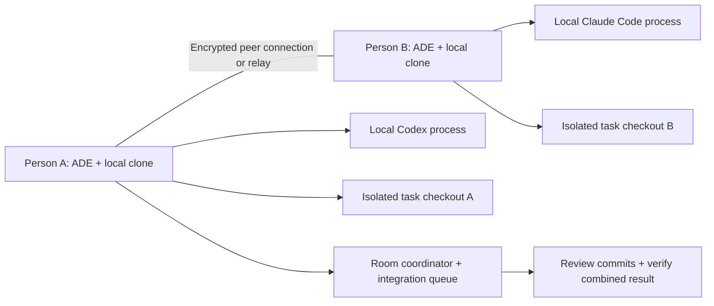

# Architecture proposal

> Scope update: we are retaining all existing Orca features and porting Orca to Tauri. [Orca foundation](07-orca-foundation.md) and [migration roadmap](08-migration-roadmap.md) supersede greenfield implementation assumptions and any apparent deferral of inherited features.

All design choices below are proposals unless marked confirmed in the decision log. Build spikes must verify provider compatibility, networking, isolation, and platform behavior before committing to a production implementation.

## Alpha protocol invariants, added after builder review

- One room binds one shared project, one repository identity, and one integration branch. Multiple projects in the sidebar are independent sharing boundaries. Each device attaches its own compatible clone. Multi-repository rooms are deferred.
- Contributors propose plan revisions; the room owner or an explicitly designated human planner publishes and approves a revision. Reviewers record findings but cannot grant implementation authority by default. The task owner can stop their task; the room owner can cancel shared work; the execution-machine owner can always stop local execution. Only the designated human integrator authorizes integration, subject to target-clone owner permissions. No shared role grants another person's tools or billing access.
- The coordinator publishes shared plan/decision Markdown on a dedicated metadata ref. Approvals bind the exact document content hash and metadata commit. Code tasks record that plan hash separately from the code base commit. Importing metadata never silently checks out or moves a participant's code branch.
- Superseding a material plan revokes new managed write/tool authorization for affected tasks. Pause the agent at the next controlled boundary, preserve partial work, and require reapproval before resuming. Record which unaffected tasks retain approval. A long-running command is interrupted/reconciled under the execution policy; a prompt asking it to pause is not sufficient enforcement.
- If checkpoint persistence or verification fails, protected writes do not begin. Proposed recovery retention: keep unresolved checkpoints until explicitly resolved/exported; offer a 30-day default for resolved local checkpoints with a visible storage limit and no silent deletion of unresolved data.
- Pairing uses a shareable opaque connection ticket containing endpoint information and coordinator fingerprint, plus local confirmation and expiry. A short human code is optional only with a separately specified rendezvous service; do not promise code-only discovery without that infrastructure.
- Receiving code is not permission to execute it. Hooks, package scripts, builds and tests require the executing owner's scoped policy or grant, including after a contribution is imported.
- Exactly-once provider billing is not promised. If ADE crashes after submitting a provider request, execution/billing may be unknown. Durable operation IDs prevent automatic ADE replay; reconciliation must precede another launch.

## Recommended execution model

Each person owns a local repository clone, an ADE runtime, and their own authenticated agent processes. A shared room coordinates tasks, plans, messages, commit exchange, and integration. It does not continuously mirror every file on every computer.

One room owner device is the initial coordinator and one designated clone owns integration. The coordinator is a local process included with ADE, not a VPS users operate. Other devices keep durable local journals. If the coordinator goes offline, local approved isolated tasks may continue; shared approvals, ownership changes, and integration pause. Reconnect restores the room. Alpha has no automatic coordinator failover: preventing split-brain takes priority. Later explicit transfer requires reconciliation and a new authority epoch.

### Alternatives considered

| Model | Strength | Cost | Decision |
|---|---|---|---|
| Each person runs local agents and a clone | Credential ownership, local performance, independent work | Commit exchange, environment mismatch, integration protocol | Recommended initial model |
| Everyone controls one shared host | One runnable environment, fewer synchronization issues | Host bottleneck, broad trust, uptime dependency | Later optional mode |
| Full filesystem synchronization | Familiar shared folder metaphor | Collision storms, dependencies and secrets, platform differences | Reject for alpha |
| Cloud development machines | Consistent hosted execution | Hosting/setup/billing conflict with brief | Outside initial scope |

## Stack and process boundaries

- Tauri 2 shell; Rust service for devices, process supervision, networking, Git operations, capabilities, and durable state.
- Proposed UI: TypeScript, React, Vite. Plain state stores and virtualized long transcripts; no always-running language server per inactive project.
- SQLite local state with migrations and transactional event/outbox writes. Versioned project plans and decisions are portable Markdown; device data and credentials never enter the repo.
- Supervised provider subprocesses over supported structured transports. A Node sidecar is optional only if an adapter genuinely requires an SDK; prefer direct subprocess integration to keep installation smaller.
- Native PTY for terminal sessions and compatibility fallback. A terminal fallback is visibly less observable and cannot claim enforced planning/isolation guarantees.
- Proposed iroh transport evaluation: direct encrypted QUIC plus relay fallback. Use an explicit relay configuration; do not silently inherit a public relay choice without operational review.
- System webviews for UI and isolated web content. External sites never receive privileged Tauri filesystem/process capabilities. Browser embedding, automation access, and remote preview streaming are separate spikes.

Tauri reduces bundled browser overhead but does not make spawned agents, terminals, browser pages, indexes, or test runners free. Measure whole-process-tree memory and CPU, alongside shell-only cost.

## Agent adapter contract

Each adapter implements discovery, version check, capability query, authentication status, session creation/resume, input, event subscription, interrupt, permission response, and shutdown. Optional features include native subagent events, structured todos, checkpoints, token usage, rate-limit windows, and tool hooks.

Normalized events: session state, turn start/end, message delta, tool proposed/start/end, approval requested/resolved, task update, subagent created/ended, usage report, error, checkpoint, and provider capability change. Preserve the original provider payload locally for debugging with redaction and bounded retention; UI fields must not imply unsupported parity.

Codex: evaluate local app-server over stdio; generate types/schema from the actual supported binary and pin a tested range. Do not expose its raw experimental WebSocket listener as ADE's multiplayer endpoint.

Claude Code: evaluate the unmodified local CLI's structured subprocess interface and the Agent SDK where appropriate. Verify session, permission callback, stream, cancellation, and subscription behavior against current terms and actual installed versions. A terminal-only path can preserve the original interactive CLI but does not automatically support rich orchestration. Do not promise a universal subscription-backed embedded SDK flow. See research log for differing authentication documentation.

BYO auth means each user signs in through provider-supported methods on their machine. ADE must not extract tokens from private caches, send credentials to peers, proxy one person's subscription to the team, or quietly switch billing modes.

## Agent collaboration and subagents

ADE owns a provider-neutral task/message layer. A participant can be a human, a top-level agent, an ADE-managed child session, or a reported provider-native subagent. Do not pretend provider-native internals are always individually addressable.

Initial roles: planner, implementer, reviewer, tester, researcher. These are task instructions plus tools/permissions, not new models. People choose provider/model when available. An ADE-managed child is a separately tracked session, potentially using another provider, billed to its execution owner. Native children stay under the provider's supported lifecycle.

Each delegation carries task ID, parent ID, allowed paths, base commit, plan revision, acceptance checks, tool grants, time/token budget, depth limit, and result format. Proposed defaults: four active agents per machine, maximum delegation depth two, and a two-exchange automatic conversation limit before escalation. These are configurable product proposals, not provider limits.

Messages carry room ID, message ID, sender identity, recipient, task ID, plan revision, base commit, reply correlation, payload hash, created time, acknowledgement, and expiry. Transport retries may deliver duplicates; receivers deduplicate durable IDs. Acknowledged means delivered, not accepted or implemented. Attachments use size limits and content hashes.

Allowed message types: question, answer, proposal, finding, dependency-ready, review-request, review-result, blocker, handoff, cancel-request. A message from a teammate's agent is task data; it does not grant shell/desktop permissions or approve another plan. Human-visible audit history links every consequential reply to the affected task. Private chats remain private unless explicitly shared.

## Repository protection

### Default isolated mode

Each writable task uses a branch in a managed worktree, or a managed separate clone when worktrees are unavailable. The UI may hide implementation details behind “Isolated workspace,” while advanced settings show exact paths and branches. Git worktrees share repository metadata and are not security boundaries; constrain Git ref operations separately.

### Worktrees off

Offer “Use current checkout” with exactly one ADE-authorized writer per checkout across all local ADE processes. Concurrent read-only analysis is allowed. Cross-machine clones still integrate through commits. Arbitrary shell commands cannot be made safe by file leases alone: enforce a restrictive tool/process boundary or clearly mark compatibility mode as weaker and serialized. If the required boundary is unavailable, do not allow simultaneous writers in that checkout.

### Write lifecycle

1. Resolve canonical repository root, realpaths and allowed scope; reject traversal and symlink/junction escape for controlled tools.
2. Record HEAD, index, tracked/untracked state, file hashes, ignored/secret exclusions, submodules, LFS, and existing modifications. Submodules and LFS are alpha detect-and-explain limitations until tested.
3. Create a protected checkpoint of eligible touched content before modification; never silently commit pre-existing user changes or secrets.
4. Bind write authorization to owner, checkout, plan revision, base state, and a fencing token. Prevent stale local processes from renewing expired authority.
5. Route managed writes through the protection boundary. Use filesystem watchers for detection, not as the authority mechanism. Recheck hashes before apply.
6. Keep incomplete output on cancellation or crash. Show a recovery diff; restoration is a new guarded operation that checks for newer user edits.
7. Review only owned paths/hunks, stage explicitly, scan eligible staged content for secrets, verify intended authorship, and commit.
8. Integrate with the designated integration owner: validate expected target HEAD, merge/cherry-pick in an integration checkout, run combined checks, and update target with compare-and-swap. On conflict retain both contributions for resolution.

Pre-existing tracked edits that overlap the task require explicit reconciliation; non-overlapping dirty changes stay untouched. Rename/delete, binary files, line endings, case-only names, executable modes, submodules, large files, disk-full, and interrupted Git locks need separate verification fixtures.

No design can guarantee arbitrary privileged agent code never touches an unrelated file. Alpha must explicitly distinguish protected execution from unrestricted local terminal operation and must not advertise worktrees as a sandbox.

## Synchronization and durable state

Room metadata uses coordinator-ordered events for task ownership, approvals, grants, integration and membership. Human draft notes may be edited locally, but shared plan revisions require explicit publish/review; no CRDT source editor is needed initially.

Use Git commit/object exchange for code contributions, over authenticated peer transport. Transfer a minimal bundle or content-addressed pack with missing-object negotiation; validate repository identity, base ancestry, object hash, quota and permitted target namespace before importing. Alpha initially requires a shared baseline commit and full compatible clones; shallow clones, submodules and LFS must be detected and handled explicitly. Never accept an incoming checkout instruction or auto-run hooks from an untrusted invite.

Journal envelope: event ID, schema version, room ID, authority epoch, sequence, actor/device ID, task ID, parent ID, timestamp, payload hash, and signature/authenticated origin. Apply events transactionally and track per-peer acknowledgement cursors. Persist an outbox before send. Replays rebuild local projections without rerunning side effects. Execution commands use durable operation IDs with states pending, started, finished, unknown. Reconnect reconciles unknown operations instead of automatically launching them again.

Room shutdown and coordinator loss do not reassign running tasks. A disconnected device cannot obtain new shared authority. Isolated previously approved work may continue under a recorded offline allowance, but cannot merge into shared integration until authority is reconciled. In current-checkout mode writers stop when their coordination lease cannot be renewed. The local broker retains the lock until it confirms the old writer has stopped; expiry alone never authorizes a competing process.

## Identity and sharing

Device keypair in OS credential storage; human display name is not sufficient identity. Expiring single-use invites bind room, coordinator fingerprint, intended permissions and a join confirmation. Verification UI shows the requesting device and room before approval. Membership keys and grants are revocable; disconnect/rekey affected peers and reject events under revoked epochs. Offline revocation cannot retroactively erase already-downloaded content.

Roles: room owner, contributor, reviewer, viewer. Roles grant room operations only. Machine access has separate owner-issued, short-lived grants: project read, approved agent task, terminal session, selected preview port, browser profile, desktop observation, desktop control. Default is own-machine execution; remote shell and desktop control are off. The device owner can revoke access immediately and local emergency stop has priority.

Remote content is untrusted. Sanitize Markdown and attachment rendering; disallow scripts and privileged links. Tool broker validates machine, path, origin, grant, operation and expiry for every call. Desktop input has one active controller per machine; browser control is scoped to a tab/profile. A peer cannot elevate privileges by placing instructions inside a file, message, webpage or annotation.

## Browser and computer use

Ship preview navigation and annotation before broad desktop control. Browser annotations contain URL/route, viewport, screenshot hash, optional selected element locator, note, project, branch, base commit and author. Avoid automatic capture of passwords/private sessions; user chooses when to share screenshots.

Native WebView support differs across Windows, macOS and Linux. An embedded browser is not automatically a Chrome automation endpoint. Evaluate platform webview control or a dedicated external browser bridge with an isolated profile; show unsupported combinations honestly. Share a localhost preview only through a narrow authenticated tunnel to an explicitly chosen port, not a blanket LAN exposure.

Desktop automation must be attached to the execution machine and provider-supported tool interface or ADE MCP bridge, with owner permission. Screen-lock, sleep, OS permission prompts, active human input, accessibility APIs, and display availability affect reliability. Alpha must not remotely drive arbitrary desktops before these cases are tested.

## Usage and lightweight operation

Store usage source, measured interval, account reference local to device, provider/model, input/output/cache token counts when available, estimated cost and rate-limit data. Separate observed task usage, provider account-wide quota, and estimates. Account quota is shared across that person's sessions: do not add percentages together. Never show missing data as zero or a guessed reset as authoritative. Avoid double-counting parent totals that already include children; flag incomplete attribution.

Index incrementally with ignore rules, lazy-load project trees, suspend inactive previews, virtualize transcripts, and cap parallel workers. Proposed performance gates: idle shell target under 250 MB on a declared reference machine, idle CPU below 1%, warm local search p95 under 150 ms for a documented fixture, and cold start under three seconds. Measure and revise explicitly; these are not Tauri guarantees. Separate shell footprint from agent processes.

## Keep-awake behavior

Keep-awake is a timed/session-scoped request to inhibit idle sleep with a visible indicator and cleanup on stop. It cannot override every lid-close, user sleep, battery, thermal or OS policy. Windows needs explicit lid-action settings where appropriate; macOS closed-display operation has hardware/power/display conditions; Linux behavior depends on its power manager. Provide detected support and platform guidance instead of a universal toggle claiming success. Do not silently change global power settings.
