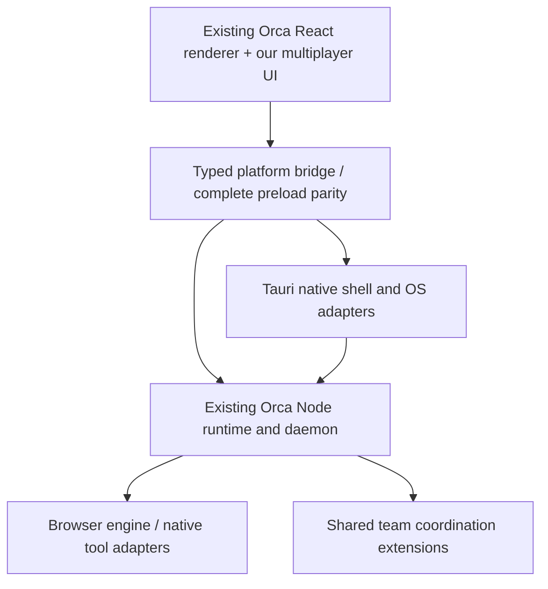

# Orca foundation and full feature parity

## Latest scope: authoritative update

The user has chosen to reuse [stablyai/orca](https://github.com/stablyai/orca) and retain **all existing Orca features**, adding our requirements only where they are missing or insufficient. This supersedes the earlier greenfield assumptions and any table that appeared to defer or remove existing upstream functionality.

Tauri remains a requirement. This is a full application port and extension, not a smaller alternative UI with a subset of Orca. Internal prototypes can be incomplete, but may not be labeled a feature-complete replacement.

## Pinned starting point

- Source repository: https://github.com/stablyai/orca
- Local working copy: `C:/Users/User/Documents/Codex/2026-11-01/orca-tauri`
- Baseline commit: `32a6c4206eb7c31e846c2d32285e5125e6fc2bc2`.
- Package version at that commit: 1.4.214; upstream package manager is pnpm 12.14.0.
- License: MIT, copyright Lovecast Inc. Preserve the upstream license and notices in reused source and distributions. Audit third-party packages/assets separately; don't treat MIT as a grant to upstream signing certificates, hosted services, domains, or provider accounts.
- Source inspection is not a baseline test pass. Upstream is large; the local checkout initially uses sparse source paths to avoid downloading site media. Sparse omission is a checkout optimization, never a product feature deletion.

Keep upstream history and a pinned reference. Develop on a separate branch. Future upstream updates are reviewed merges with parity checks, not an untracked copy-and-paste dump.

## Concrete reuse seams already found

| Source | Observed evidence | Implication |
|---|---|---|
| `vite.web.config.ts` | Separate React/Vite renderer build | Start Tauri from the existing renderer entry and build process |
| `src/renderer/src/web/main.tsx` | Web startup installs an API bridge then loads the same App | A platform bridge already exists; preserve the application tree |
| `src/renderer/src/web/web-preload-api.ts` | Runtime-backed equivalents for desktop API namespaces | Reuse transport mappings; audit unavailable or stubbed methods before claiming parity |
| `src/preload/index.ts` and `api-types.ts` | Typed Electron preload surface | Inventory and preserve the complete API contract, not only the visible panes |
| `config/scripts/build-orcad-node.mjs` | Builds the Node runtime distribution | A reusable local runtime is already a first-class upstream artifact |
| `config/scripts/build-orcad.mjs` | Build graph checks for Electron imports and Node load smoke tests | Prefer this seam over rewriting the backend into Rust; these checks must actually run |
| `src/main/runtime`, `src/main/daemon`, `src/packages/process-host` | Runtime, daemon and process abstractions | Preserve agent/process/Git behavior and upstream regression tests |
| `src/main/claude`, `src/main/codex`, usage/account modules | Existing provider implementations | Extend existing adapters rather than inventing duplicate integrations |
| `src/main/runtime/device-entry.ts` | Device identity, grants, revocation-related state | Extend existing pairing/authorization model after auditing semantics |
| `src/main/browser` | Many Electron imports, including agent-browser paths | Browser parity is a distinct migration project, not a webview setting |
| `mobile/`, `cloud/` | Companion and relay workspaces are present upstream | Preserve protocols/features; determine infrastructure we can legitimately operate |
| `docs/STYLEGUIDE.md`, renderer `assets/main.css` | Canonical design system | Real port keeps upstream tokens/primitives; new multiplayer UI extends them |

Source links should use the pinned commit during implementation review. Avoid assuming moving `main` matches this baseline.

## Recommended Tauri architecture

Preserve Orca's React renderer and its Node-based runtime. Add a small Tauri/Rust native shell and compatibility bridge for native desktop concerns. Start with upstream's existing web/runtime separation, then fill its capability gaps. Rust owns shell lifecycle, native window integration, secure runtime launch/attachment, OS credentials where needed and supported native bridges. The existing runtime owns agent sessions, PTYs, Git, indexing, provider integrations and other behavior it already implements.

A bundled runtime must be launched automatically; users must not install Node, configure ports or operate a daemon manually. Use authenticated local transport and a clear process lifecycle. Closing a window, quitting the app, background execution and stopping an agent are distinct operations; preserve existing session continuity.

Do not bundle or launch Electron invisibly as a shortcut and call that a complete Tauri migration. An intermediate experiment may use the existing Electron app as a comparison baseline, but the final native shell must not depend on Electron. A separate Chromium engine may still be necessary for browser parity; measure and disclose its cost. Tauri's system webview does not magically replace Chromium-specific browser tools on every platform.

## Preserve the full baseline

The following groups are a minimum inventory, not permission to drop unlisted features. The machine-readable [documentation parity register](orca-feature-parity.csv) captures all 58 documentation pages under the pinned upstream docs tree; pages are inventory seeds, not 58 proven independent features. The [API parity register](orca-api-parity.csv) records 91 preload entries and complements it. Audit source-only capabilities, runtime routes, settings, plugins, native integrations and release notes before declaring completeness.

| Feature family | Required treatment |
|---|---|
| All existing agent providers and CLI compatibility | Keep; Codex/Claude receive our initial multiplayer enhancements first |
| Native chats, terminal agent sessions, histories, resume, hibernation | Preserve modes, data and lifecycle |
| Agent accounts, usage, quotas and account switching | Preserve supported behavior and user-owned authentication; extend team attribution |
| Parallel worktrees and existing folder workspaces | Preserve both; add stronger ownership/integration where missing |
| Projects, grouping, tabs, panes, splits, restore, quick-open | Reuse existing UI/state and extend missing search scopes |
| Terminal rendering, PTY behavior, persistence, shells and WSL | Preserve cross-platform and remote semantics; verify native dependencies |
| Monaco/editor, autosave, file explorer, drag/drop, file watching | Preserve editing behavior and prevent data-loss regressions |
| Markdown, images, PDF and other viewers/notebooks | Preserve reader and editor surfaces |
| Git status/diffs, annotations, attribution, commit/push/review | Preserve functionality; extend planned/checkpointed team integration |
| GitHub, GitLab, Bitbucket, Linear, Jira and hosted review integrations present in source | Preserve local/remote behavior; hosted service access may need our own configuration |
| Browser tabs/profiles, design mode, screenshots and agent-browser tooling | Preserve capabilities with a tested Tauri-compatible browser architecture |
| Computer use, permission surfaces, native automation | Preserve supported OS/device behavior; add teammate-scoped grants |
| SSH, remote servers, runtime environments, tunnels and pairing | Preserve; add effortless team connectivity without requiring a VPS |
| Mobile companion and relay protocols | Preserve; avoid implying access to upstream app-store identities or hosted endpoints |
| CLI, orchestration, automations, skills, hooks, memory, checkpoints | Keep and extend; do not replace with a parallel framework without necessity |
| Notifications, unread/activity state, speech, dashboards and settings | Preserve relevant native and runtime behavior |
| Plugins, themes, diagnostics, telemetry consent, exports, updates and local builds | Preserve functionality and consent controls; configure our own legitimate service endpoints |
| Emulator, VM and other source-only capabilities | Inventory and retain; absence from marketing is not grounds for deletion |
| Keep-awake and OS-specific sleep behavior | Audit existing agent-awake code before adding another implementation |

## Our additions: audit before adding

| User requirement | Existing evidence | Planned delta |
|---|---|---|
| Many projects/chats/tabs/splits/themes | Existing renderer and state | Preserve; add only missing sidebar/search affordances |
| Optional worktrees | Worktree and folder-workspace APIs | Preserve modes; introduce accountable writer policy where needed |
| Codex/Claude usage | Existing provider/account modules | Extend exact team/task attribution only when data supports it |
| Browser annotation | Existing design mode | Reuse annotation capture and task linking; audit cross-person sharing |
| Computer/browser agent access | Existing tools and permission APIs | Add per-owner remote grants and teammate attribution |
| Subagents and agent conversation | Existing orchestration and provider child handling | Map native features first; add durable cross-person coordination where missing |
| Reliable multiplayer | Pairing, remote runtime and device grants already exist | Add/verify human team membership, shared plans, distributed local execution and integration semantics |
| Never lose local work | Existing checkpoints/trust/Git safeguards | Compare against our fail-closed recovery invariants and close specific gaps |
| Strong repo foundation | Existing preflight/setup/hooks | Extend baseline/goal evidence and acceptance linkage if missing |
| Plans before implementation | Existing agent modes and orchestration | Versioned shared plan approvals and enforcement tied to tasks |
| Keep awake / lid handling | Existing awake and OS modules | Preserve supported behavior, verify platform claims, expose truthful status |

“Existing evidence” means source surfaces were located. It does not mean their behavior fully satisfies the new requirement. Read owning modules and run focused checks before deciding no work is needed.

## Policy, profiles and platform invariants

- **Two acceptance axes:** preserve upstream capability and verify our managed-collaboration policy separately. Intentional stricter approvals are documented policy changes, not silently classified as missing features or parity successes.
- **Managed execution:** ADE-launched implementation tasks require an approved plan and the available protection boundary. Exploration stays read-only. Child agents, hooks and automations launched under a managed task inherit its limits; they cannot route around its policy.
- **Compatibility execution:** original interactive terminal/agent modes remain available when deliberately selected, with visible mode identification. They do not claim enforced planning or protected writes. Manual terminal commands are user actions; ADE must not market unrestricted execution as covered by its managed guarantees. The default for our shared agent tasks is managed mode.
- **Independent profile:** use our own application ID, profile/database directories, sockets, ports, OS credential namespace, updater channel and URL scheme. Running alongside original Orca must not mutate its data or attach to its daemon accidentally. Reuse its code, not an ambient running service merely found at a familiar address.
- **Existing user data:** automatic import from an installed Orca is not assumed. Preserve upstream import/export capabilities. A future explicit migration copies supported non-secret data into a new versioned profile with verification and rollback; original profiles remain untouched. Provider sessions use supported sign-in/resume routes, not credential-file copying. Browser-profile and secret migration need separate owner-approved designs.
- **Runtime ownership:** authenticated launch/attach, per-launch identity/nonce, protocol version negotiation, exclusive supervisor ownership, verified packaged-runtime integrity and crash reconciliation are mandatory. Refuse incompatible or foreign runtimes. Stopping the Tauri shell must not kill a runtime owned by another installation or silently orphan managed work.
- **Platform scope:** public full parity targets all desktop OS/architecture combinations supported by the pinned upstream release, including applicable remote and mobile companion behavior. Windows-first is only an internal validation order, not a reduction of final scope. Inventory upstream's exact minimum versions/architectures before installers are promised; never describe untested macOS/Linux/mobile behavior as verified.

## Compatibility and full-parity gate

Each inventory item needs source owner, upstream test/fixture, Electron baseline result, Tauri result, local/remote/mobile applicability, migration treatment and known limitations. Statuses: unassessed, reusable, adapter required, behavior change required, implemented, verified. A stub or hidden button is not a migrated feature.

Compare both implementations against the same fixtures, provider versions and OS conditions. Preserve state/schema migrations, keyboard behavior, permission decisions and failure recovery. Carry forward upstream tests when applicable; add tests only for changed boundaries and our new coordination rules. Keep lintapple alongside upstream checks, using the canonical Orca tokens for real ported UI.

Feature completeness cannot be claimed while required entries are silently missing, permanently stubbed, only present in an Electron fallback, or dependent on unauthorized upstream hosted infrastructure. Platform limitations already present in Orca remain documented; the port must not add unexplained regressions.

## Performance within the full-feature requirement

Optimize through lazy loading, suspended inactive panes, on-demand browser processes, shared runtime services and bounded concurrency. Do not delete features to make memory numbers smaller. Measure Tauri shell alone and the full feature-active process tree separately. Retaining an external browser/runtime costs memory; the full product's actual footprint matters more than the shell label.
